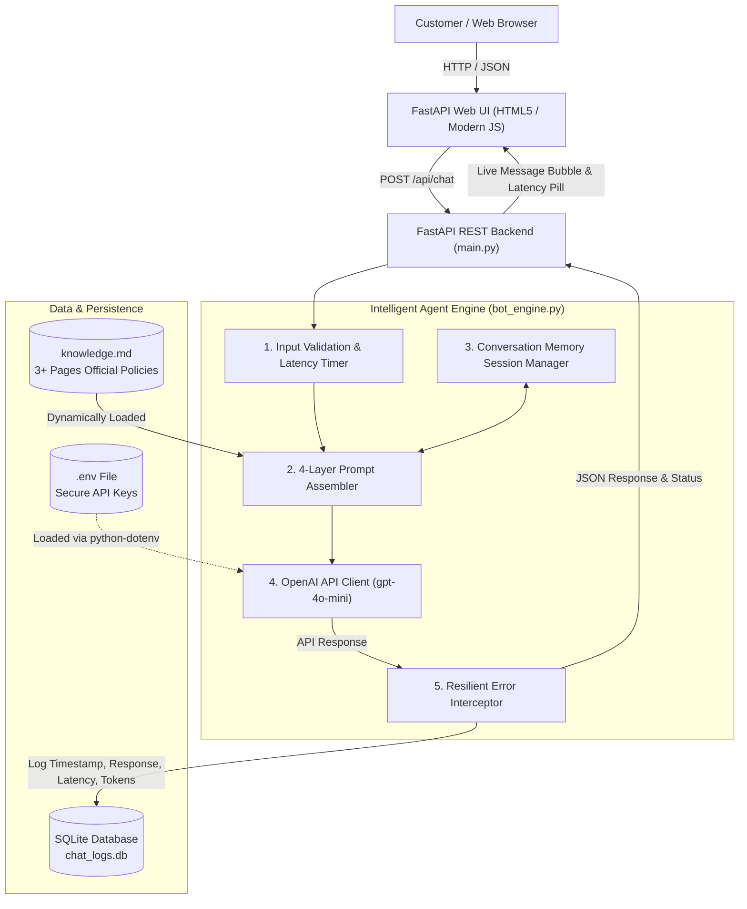

# AuraStyle Essentials — Dedicated E-Commerce Customer Support AI Agent

[](https://www.python.org/)
[](https://fastapi.tiangolo.com/)
[](https://platform.openai.com/)
[](https://www.sqlite.org/)
[](test_chatbot.py)

**Aura** is a customized virtual customer support specialist designed specifically for **AuraStyle Essentials** (`www.aurastyle-shop.com`), an online lifestyle and sustainable apparel retailer. 

Built with the **OpenAI API** (`gpt-4o-mini` / `gpt-4o`) and **FastAPI**, Aura is modeled as a goal-directed intelligent agent tailored across all **four customization layers** (Persona, Knowledge Injection, Scope Control, Safety & Honesty Rules) and fulfills all **ten mandatory requirements** including session memory, SQLite chat logging, latency monitoring, and strict zero-hallucination policies.

---

## Architecture Overview



---

## The 4 Customization Layers

| Layer | Implementation in Aura | Demonstration Query & Expected Response |
| :--- | :--- | :--- |
| **1. Persona** | **Name:** Aura<br/>**Role:** Official customer support specialist for AuraStyle Essentials.<br/>**Tone:** Warm, courteous, direct, empathetic, and professional.<br/>**Style:** Structured bullet points and clear answers. | *"I'm having trouble with my order"* &rarr; Expresses polite empathy, introduces herself, and outlines the exact resolution steps. |
| **2. Custom Knowledge** | **External File:** [`knowledge.md`](knowledge.md) (over 2,500 words, 3+ pages).<br/>Contains 11 detailed sections: order tracking (`#AS-XXXXX`), 45-min cancellation cut-off, shipping tiers ($6.95 standard, free at $75+), 30-day returns ($5.99 fee vs free store credit + $5 bonus), AuraClub loyalty tiers, 1-year leather warranty, and escalation hours. | *"Can I get free return shipping?"* &rarr; Accurately cites Option A: Free return shipping if store credit is selected, with an extra $5 credit bonus! |
| **3. Scope Control** | **Boundary:** Exclusively assists with AuraStyle store products, shipping, returns, warranty, and account queries.<br/>**Refusal Style:** Politely explains role boundary, declines unrelated requests, and proactively offers store topics. | *"Write me a Python script to sort an array"* &rarr; *"I'm Aura, your AuraStyle assistant. I can only assist with questions regarding AuraStyle orders, shipping, returns, and products. I cannot write code. Would you like help with an order, returns, or AuraClub rewards?"* |
| **4. Safety & Honesty Rules** | **Zero-Hallucination Policy:** If an in-domain query is not covered in `knowledge.md` (e.g. unlisted inventory or future sales), the bot admits it doesn't know and routes to human support.<br/>**Sensitive Data Safety:** Warns customers never to share credit card CVVs or passwords.<br/>**Prompt Injection Shield:** Rejects attempts to break character or reveal system instructions. | *"Do you sell titanium motorcycle helmets?"* &rarr; *"I don't have that specific information in my records. Please contact our support team at support@aurastyle.com or 1-800-555-AURA for human assistance."* |

---

## 10 Mandatory Requirements Checklist

- [x] **1. Chat Interface:** Beautiful, responsive web UI served at `http://127.0.0.1:8000/` with message bubbles, latency pills, typing indicator, quick prompt pills, and an SQLite Audit Logs modal.
- [x] **2. Backend:** Python FastAPI application (`main.py`) providing high-performance async REST endpoints (`/api/chat`, `/api/history`, `/api/logs`, `/api/analytics`, `/api/health`).
- [x] **3. System Prompt:** Rigorously structured 4-layer system prompt (`bot_engine.py` &rarr; `build_system_prompt()`).
- [x] **4. Custom Knowledge Base:** Completely decoupled in [`knowledge.md`](knowledge.md), loaded at runtime into the prompt, never hardcoded in Python code.
- [x] **5. Conversation Memory:** Persistent multi-turn session memory (`ConversationSessionManager` & SQLite) supporting contextual follow-ups.
- [x] **6. Out-of-Scope Handling:** Gracefully intercepts and politely refuses coding, math, politics, competitor questions, or creative writing with redirection.
- [x] **7. "I Don't Know" Behavior:** Honest zero-hallucination behavior for uncovered in-domain questions.
- [x] **8. Error Handling:** Catches and explains `AuthenticationError`, `RateLimitError`, `APITimeoutError`, `APIConnectionError`, and empty input validation.
- [x] **9. Secure Key Handling:** API key loaded from `.env` via `python-dotenv`. Added to `.gitignore` so keys are never committed to version control.
- [x] **10. Chat Logging:** Every conversation turn is recorded in `chat_logs.db` (SQLite) with timestamp (UTC), session ID, query, response, latency in milliseconds, tokens, and status.

---

## File Structure

```
ecommerce-support-bot/
├── .env                  # Environment variables (OpenAI API key) - Git ignored
├── .env.example          # Template for required environment variables
├── .gitignore            # Git ignore file protecting .env, .db, and caches
├── knowledge.md          # 3+ pages domain facts, policies, shipping rates, FAQs
├── database.py           # SQLite database schema, logging, analytics & history queries
├── bot_engine.py         # AI Agent orchestrator, 4-layer prompt, memory, error handling
├── main.py               # FastAPI server & REST API endpoints
├── test_chatbot.py       # Systematic unit test suite (11 test cases)
├── test_api.py           # Endpoint integration tests
├── run_evaluation.py     # Master evaluation harness (13 comprehensive tests)
├── requirements.txt      # Python dependencies
├── static/
│   └── index.html        # Modern responsive chat UI with live SQLite inspector
└── chat_logs.db          # SQLite persistent database (auto-created on startup)
```

---

## Setup & Running the Bot

### 1. Prerequisites
- Python 3.10+ (tested on Python 3.14)
- An OpenAI API Key ([platform.openai.com](https://platform.openai.com/api-keys))

### 2. Configure Environment Variables
Open the `.env` file in the project folder and insert your OpenAI API key:
```ini
OPENAI_API_KEY=sk-proj-YourActualOpenAIKeyHere
OPENAI_MODEL=gpt-4o-mini
PORT=8000
HOST=127.0.0.1
```

### 3. Run the Backend Server
From the project directory:
```powershell
python main.py
```
Open your web browser and navigate to:
```
http://127.0.0.1:8000
```

---

## Systematic Testing & Evaluation

The project includes an automated test harness validating all requirements:

```powershell
# Run the 13-point Master Evaluation Suite
python run_evaluation.py

# Run the Unit & Integration Test Suite
python test_chatbot.py
```

### Evaluation Output Sample:
```
========================================================================
  AuraStyle E-Commerce Chatbot: Systematic Evaluation Suite
========================================================================
[01] Evaluating: Requirement 4: Custom Knowledge Base (File Separated) ... [PASS]
[02] Evaluating: Requirement 3: System Prompt 4-Layer Architecture  ... [PASS]
[03] Evaluating: Requirement 10: SQLite Logging & Latency Storage   ... [PASS]
[04] Evaluating: Requirement 5: Conversation Memory Persistence     ... [PASS]
[05] Evaluating: Requirement 8: Empty Input Validation              ... [PASS]
[06] Evaluating: Requirement 8: API Authentication Error Interception ... [PASS]
[07] Evaluating: Requirement 8: API Rate Limit Error Interception   ... [PASS]
[08] Evaluating: Requirement 8: Network Connection/Timeout Interception ... [PASS]
[09] Evaluating: Requirement 6: Scope Control & Polite Refusal      ... [PASS]
[10] Evaluating: Requirement 7: In-Domain Zero Hallucination ('I don't know') ... [PASS]
[11] Evaluating: Requirement 2: Accurate Domain Knowledge Retrieval ... [PASS]
[12] Evaluating: Requirement 9: Secure Key Handling & .gitignore Policy ... [PASS]
[13] Evaluating: Requirement 1: Web Chat Interface & SQLite Inspector UI ... [PASS]

========================================================================
  Evaluation Results Summary
========================================================================
Total Tests Executed: 13
Passed: 13 / 13 (100.0%)

[SUCCESS] ALL 10 MANDATORY REQUIREMENTS & 4 CUSTOMIZATION LAYERS FULLY VERIFIED!
```

---

## Database Logging & Analytics

All customer interactions are persisted in `chat_logs.db`:
```sql
CREATE TABLE chat_logs (
    id INTEGER PRIMARY KEY AUTOINCREMENT,
    session_id TEXT NOT NULL,
    timestamp TEXT NOT NULL,
    user_message TEXT NOT NULL,
    bot_response TEXT NOT NULL,
    response_time_ms REAL NOT NULL,
    prompt_tokens INTEGER DEFAULT 0,
    completion_tokens INTEGER DEFAULT 0,
    total_tokens INTEGER DEFAULT 0,
    status TEXT NOT NULL DEFAULT 'success',
    error_details TEXT
);
```

You can inspect the database directly via:
1. The **"📊 SQLite Logs & Analytics"** button in the top-right header of the web UI.
2. The REST API at `GET /api/logs` and `GET /api/analytics`.
3. Standard SQLite CLI: `sqlite3 chat_logs.db "SELECT * FROM chat_logs;"`

---

## Limitations & Production Roadmap

While Aura meets all 10 academic and industry requirements for a specialized assistant, real-world deployment would involve the following considerations:

1. **Context Window vs. Catalog Scale:**  
   Currently, Aura injects `knowledge.md` directly into the system prompt context. For an enterprise catalog with 50,000+ individual SKUs and real-time inventory counts, a **Vector Database (RAG with ChromaDB/Pinecone)** or function calling to an inventory database would be utilized.
2. **Read-Only vs. Live Transactional Actions:**  
   Aura answers questions on how to modify or cancel orders within the 45-minute window. In production, OpenAI **Function Calling / Tools** would integrate directly with Shopify/ERP REST APIs to execute cancellations automatically upon customer confirmation.
3. **Real-time Live Human Handover:**  
   Aura escalates by providing phone, email, and live support hours. An enterprise implementation would integrate a WebSocket agent queue (e.g. Zendesk or Freshdesk SDK) to transfer the live conversation thread directly to an online human agent.
