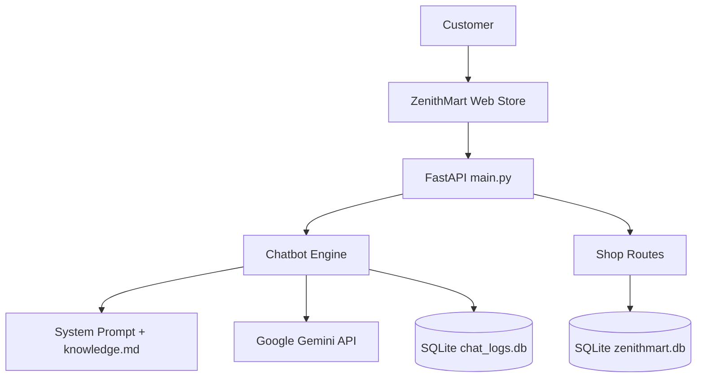

# ZenithMart — AI-Powered E-Commerce Demo

ZenithMart is a demo e-commerce application with a dedicated AI customer-support assistant named **Aura**. Aura uses **Google Gemini** through Google's OpenAI-compatible API and answers store questions using the project's local knowledge file.

> **Demo notice:** Product catalogue data, prices, inventory, payment processing, and order workflows are for demonstration. Do not enter real payment credentials or sensitive personal information.

## Features

- **Gemini-powered chatbot:** Aura responds to ZenithMart-related questions.
- **Domain knowledge:** Store policies are loaded from `knowledge.md`.
- **Conversation memory:** Recent turns are retained per session and chat history is stored in SQLite.
- **E-commerce API:** Product listing/details, order creation, order lookup, order progression, and customer requests.
- **FastAPI backend:** Serves the storefront and JSON API.
- **SQLite persistence:** Separate databases support chatbot logs and the demo shop.
- **Docker-ready project:** See `docker-compose.yml` for the services configured in this repository.

## Architecture



## Technology Stack

- Python
- FastAPI
- Google Gemini API (OpenAI-compatible client)
- SQLite
- HTML, CSS, JavaScript
- Docker / Docker Compose (where configured)

## Project Structure

```
.
├── main.py                 # FastAPI application and web routes
├── bot_engine.py           # Gemini client, prompt, memory, and chat logic
├── knowledge.md            # ZenithMart support policies and FAQs
├── knowledge_zenithmart.md # Duplicate/reference copy of store knowledge
├── database.py             # Chat history and analytics persistence
├── shop_routes.py          # Product and order API routes
├── shop_db.py              # Demo catalogue and order database
├── shop.html               # Storefront page
├── static/                 # Static assets
├── requirements.txt        # Python dependencies
├── .env.example            # Environment variable template
└── docker-compose.yml      # Container configuration
```

## Setup

### 1. Requirements

- Python 3.10 or newer
- A Google Gemini API key
- Internet access for Gemini API requests

### 2. Create and activate a virtual environment

**Windows PowerShell:**

```powershell
python -m venv .venv
.\.venv\Scripts\Activate.ps1
```

### 3. Install dependencies

```powershell
python -m pip install -r requirements.txt
```

### 4. Configure Gemini

Copy `.env.example` to `.env` and add your own Gemini API key:

```env
GEMINI_API_KEY=your_gemini_api_key_here
GEMINI_MODEL=gemini-flash-latest
PORT=8000
HOST=127.0.0.1
```

Keep `.env` private. Never commit your real API key to GitHub.

### 5. Run the application

```powershell
python main.py
```

Open [http://127.0.0.1:8000](http://127.0.0.1:8000) in your browser.

The health endpoint is available at [http://127.0.0.1:8000/api/health](http://127.0.0.1:8000/api/health).

## API Overview

| Method | Endpoint | Purpose |
|---|---|---|
| GET | `/api/health` | Check API status and whether a Gemini key is loaded |
| POST | `/api/chat` | Send a message to Aura |
| GET | `/api/history/{session_id}` | Retrieve a session's chat history |
| POST | `/api/clear` | Clear a chat session |
| GET | `/api/stats` | Retrieve chat analytics |
| GET | `/api/products` | List demo products |
| GET | `/api/products/{pid}` | Get one product |
| POST | `/api/orders` | Create a demo order |
| GET | `/api/orders` | List orders for a customer |
| GET | `/api/orders/{oid}` | Get a customer's order |
| POST | `/api/orders/{oid}/advance` | Advance a demo order status |
| POST | `/api/orders/{oid}/request` | Submit a demo order request |

See `main.py` and `shop_routes.py` for request schemas and validation details.

## Knowledge and Safety

Aura uses `knowledge.md` as its store-policy source. It should not invent shipping rates, return eligibility, product availability, or order information. The current chatbot is not itself connected to live order lookup tools; use the store's order API for actual demo order data.

The demo checkout/payment flow is simulated. Never collect or share card numbers, CVVs, passwords, or OTPs.

## Testing

Run the test files from the project root after installing dependencies:

```powershell
python -m unittest
```

If a test fails, inspect the traceback and compare the test with the current API implementation. Do not treat a passing mocked Gemini response as proof that the live Gemini API is configured correctly.

## Current Limitations

- Gemini requests require a valid API key, network access, and a supported model name.
- Chatbot answers are grounded in the local knowledge file; the chatbot does not yet call the product/order database as tools.
- Store catalogue, stock, payments, and order workflows are demo data and simulated.
- The `knowledge.md` and `knowledge_zenithmart.md` files currently contain the same content; keep them synchronized or consolidate them in a later cleanup.
